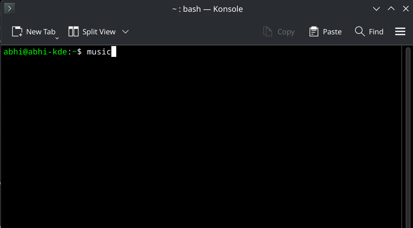
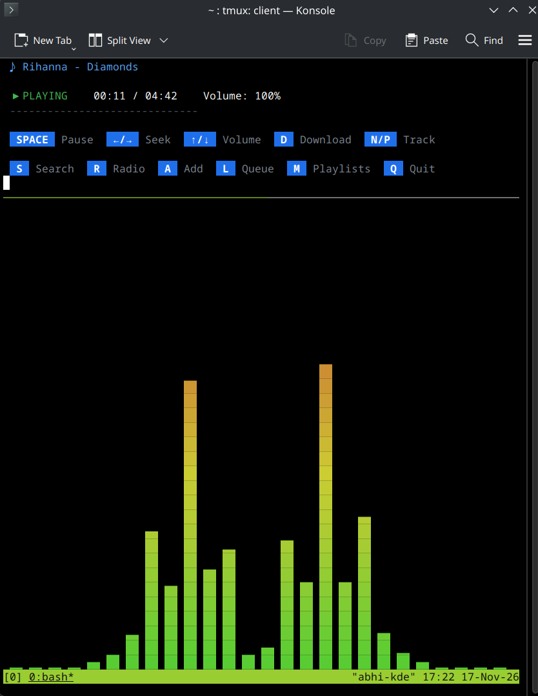
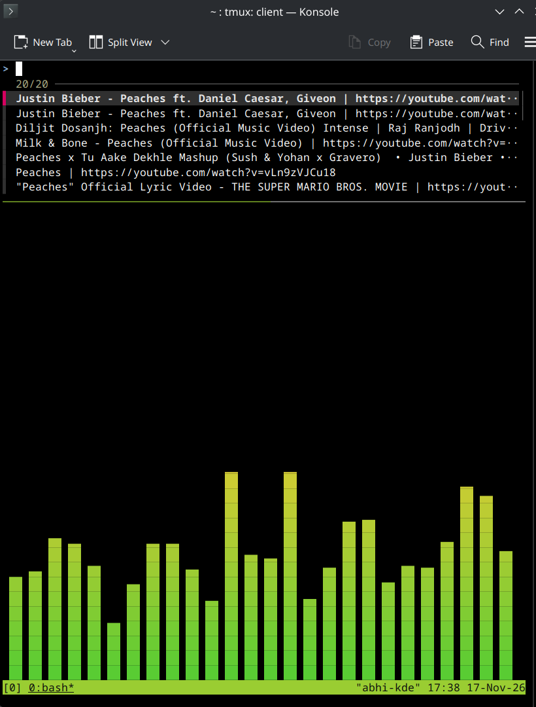
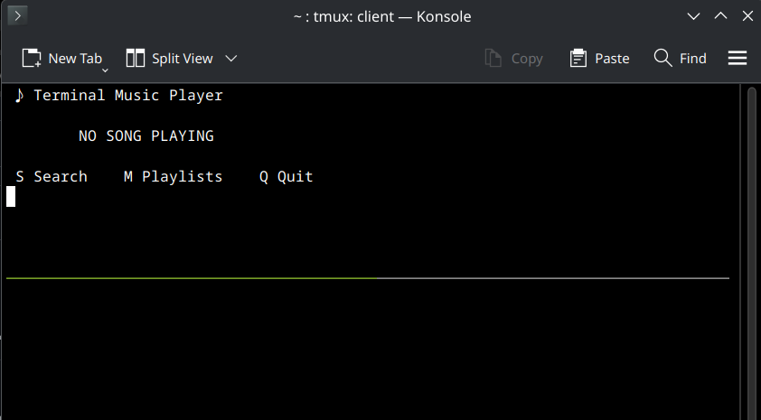
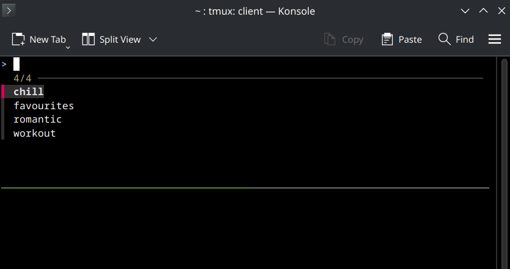

<div align="center">

# 🎵 Linux Terminal Music Player

**A fast, lightweight, true-color terminal music player with a 60 FPS spectrum visualizer, YouTube Music Song Radio, background MP3 downloads, and YouTube playlist sync.**

[](https://github.com/ABHI2ME/linux-terminal-music-player)
[](https://github.com/ABHI2ME/linux-terminal-music-player)
[](https://github.com/ABHI2ME/linux-terminal-music-player)

[Install](#-installation) • [Features](#-features) • [Screenshots](#-screenshots) • [Usage](#-usage) • [Controls](#-keyboard-controls) • [How it works](#-how-it-works) • [YouTube sync](#-youtube-playlist-export-optional) • [Troubleshooting](#-troubleshooting)

</div>

---

<!--
  SCREENSHOTS: create an `assets/` folder in the repository and upload
  player-main.png, song-radio.png and playlist-manager.png.
  If you don't want screenshots, delete the whole "Screenshots" section below.
-->

## 📸 Screenshots

<table>
  <tr>
    <td align="center" width="50%">
      
      <br><sub><b>Startup</b>: idle player, ready for a search</sub>
    </td>
    <td align="center" width="50%">
      
      <br><sub><b>Now playing</b>: 60 FPS Cava visualizer under the controller</sub>
    </td>
  </tr>
</table>

<details>
<summary><b>More screenshots: search, options and playlists</b></summary>
<br>
<table>
  <tr>
    <td align="center" width="50%">
      
      <br><sub><b>Search</b> (<code>S</code> / <code>A</code>): pick a song with fzf</sub>
    </td>
    <td align="center" width="50%">
      
      <br><sub><b>Player options</b> and controls</sub>
    </td>
  </tr>
  <tr>
    <td align="center" width="50%">
      
      <br><sub><b>Playlist selection</b> (<code>M</code>)</sub>
    </td>
    <td align="center" width="50%">
      
      <br><sub><b>Queue and playlist manager</b> (<code>L</code> / <code>M</code>)</sub>
    </td>
  </tr>
</table>
</details>

---

## ✨ Features

- **⚡ True-color TUI (`music-control`)**
  A responsive Bash interface that talks to an audio-only `mpv` through its JSON IPC socket using `socat` and `jq`. No browser, instant startup, tiny memory footprint.
- **📊 60 FPS spectrum visualizer (`cava`)**
  Opens in a split `tmux` pane below the player with a custom 8-stop green-to-red gradient, reading your PulseAudio / PipeWire output.
- **📻 YouTube Music Song Radio (`R`)**
  Takes the song that is playing, fetches 25 similar tracks from YouTube Music via `ytmusicapi`, and lets you pick one with `fzf` to **Play now (`P`)** or **Add to queue (`A`)**.
- **🛡️ 3-attempt playback guard (`stop-on-error.lua`)**
  If a stream fails or is throttled, it retries the same song up to 3 times (1 second apart), then stops cleanly instead of racing through your whole queue.
- **⬇️ Background MP3 downloads (`D`)**
  Press `D` to convert the current track to best-quality `.mp3` in `~/Music/` without interrupting playback, with a desktop notification when it finishes.
- **📂 Local playlists and fuzzy queue (`M` / `L`)**
  Save a song or your whole queue to plain-text playlists, and jump to any queued song by name or number.
- **☁️ YouTube playlist export (`music-export`)**
  Copies a local playlist into a private playlist on your YouTube channel, with duplicate detection, channel ownership checks and resume support for interrupted exports.
- **🎬 Video downloader (`ytv`)**
  Download YouTube videos at best quality, or capped at `1080`, `720` or `480`, into `~/Videos/`.
- **🖱️ Menu launcher**
  The installer adds a "Terminal Music Player" entry to your application menu (and a desktop icon) so you can start it with a click.

---

## 🚀 Installation

**Supported systems:** Linux Mint (including XFCE), Ubuntu and Debian, i.e. anything that uses `apt`. Run it as your normal user, not as root; `sudo` is requested only for installing packages.

### One command

```bash
curl -fsSL -o install-music-player.sh https://raw.githubusercontent.com/ABHI2ME/linux-terminal-music-player/main/install-music-player.sh
bash install-music-player.sh
```

### Or with the file

1. Download `install-music-player.sh` from this repository.
2. Right-click it, open **Properties → Permissions**, and enable **Allow this file to run as a program**.
3. Double-click it. It opens itself in a terminal window.

The installer takes a minute or two. When it finishes, open **Terminal Music Player** from your application menu, or type `music`.

### What the installer does

| Step | Details |
| :--- | :--- |
| **System packages** | `mpv`, `cava`, `tmux`, `socat`, `jq`, `fzf`, `ffmpeg`, `libnotify-bin`, `curl`, `unzip`, `nano`, `python3-venv`, `python3-pip` |
| **JS runtime** | [Deno](https://deno.com) in `~/.deno`, which `yt-dlp` needs to solve YouTube's JavaScript challenges |
| **Three isolated Python venvs** | `yt-dlp-venv` (`yt-dlp[default]`), `radio-venv` (`ytmusicapi`), `youtube-venv` (Google API client). System Python is never touched. |
| **Commands** | `music`, `music-control`, `music-radio`, `music-export`, `ytv` in `~/.local/bin` (no root-owned files) |
| **Configs** | Visualizer config at `~/.config/cava/config`, playback guard at `~/.local/share/music-player/` |
| **Launcher** | Application-menu entry and desktop icon |
| **Shell setup** | Adds a small marked block to `~/.bashrc` so `~/.local/bin` is in your `PATH` |

Existing files are never overwritten silently; a `.bak` copy is made first. If `cava` is not available in your repositories, the installer warns you and the player still works without the visualizer.

### Uninstall

```bash
bash install-music-player.sh --uninstall
```

This removes the commands and virtual environments. **Your playlists are kept** in `~/.local/share/music-player/playlists/`.

---

## 🎮 Usage

```bash
# Start the player (idle, then press S to search)
music

# Search YouTube and start playing straight away
music "Kanye West Can't Tell Me Nothing"

# Copy a local playlist to your YouTube account
music-export

# Download a video in best quality to ~/Videos
ytv "https://www.youtube.com/watch?v=..."

# Download a video capped at 1080p (or 720 / 480)
ytv 1080 "https://www.youtube.com/watch?v=..."
```

> Always wrap URLs in double quotes with `ytv`, otherwise the shell treats the `&` in YouTube links as a background job.

---

## ⌨️ Keyboard Controls

| Key | Action |
| :---: | :--- |
| **`Space`** | Pause / resume |
| **`←` / `→`** | Seek −5s / +5s |
| **`↑` / `↓`** | Volume +5% / −5% |
| **`S`** | Search YouTube and replace the current queue |
| **`A`** | Search YouTube and add a song to the queue |
| **`R`** | Song Radio: 25 suggestions, then `P` play now or `A` add to queue |
| **`L`** | Queue viewer: jump to any track by name or number |
| **`N` / `P`** | Next / previous track |
| **`D`** | Download the current song as MP3 to `~/Music/` |
| **`M`** | Playlists menu: `1` Play, `2` Add current song, `3` Create, `4` View / remove songs, `5` Delete, `6` Save whole queue |
| **`Q`** | Quit: stops `mpv`, removes the socket, closes the `tmux` session |

---

## 🏗️ How It Works

```text
┌──────────────────────────────────────────────────────────────────────┐
│                         tmux split session                           │
│  ┌────────────────────────────────────────────────────────────────┐  │
│  │  Top pane: music-control (Bash TUI)                            │  │
│  │   ├── S / A  ──► yt-dlp + fzf search                           │  │
│  │   ├── R      ──► music-radio (ytmusicapi, 25-track radio)      │  │
│  │   └── D      ──► background yt-dlp MP3 rip + notify-send       │  │
│  └───────────────────────────────┬────────────────────────────────┘  │
│                                  │ JSON IPC (/tmp/abhi-music.sock)   │
│                                  ▼                                   │
│  ┌────────────────────────────────────────────────────────────────┐  │
│  │  Background engine: mpv --no-video + stop-on-error.lua         │  │
│  └───────────────────────────────┬────────────────────────────────┘  │
│                                  │ PipeWire / PulseAudio stream      │
│                                  ▼                                   │
│  ┌────────────────────────────────────────────────────────────────┐  │
│  │  Bottom pane: cava (60 FPS, 8-stop gradient visualizer)        │  │
│  └────────────────────────────────────────────────────────────────┘  │
└──────────────────────────────────────────────────────────────────────┘
```

### Files and folders

| Path | Purpose |
| :--- | :--- |
| `~/.local/bin/music` | Launcher: starts `mpv` in the background and builds the `tmux` layout |
| `~/.local/bin/music-control` | The Bash TUI controller |
| `~/.local/bin/music-radio` | Song Radio recommendation picker |
| `~/.local/bin/music-export` | Wrapper that runs the exporter in its own venv |
| `~/.local/bin/music-youtube-export.py` | YouTube Data API v3 playlist exporter |
| `~/.local/bin/ytv` | Video downloader |
| `~/.local/share/music-player/stop-on-error.lua` | 3-attempt retry and stop guard for `mpv` |
| `~/.local/share/music-player/playlists/*.txt` | Saved playlists, one `Title \| URL` per line |
| `~/.local/share/music-player/youtube-exports/` | Remembers which YouTube playlist each local playlist is linked to |
| `~/.config/cava/config` | Visualizer settings |
| `~/.config/music-player/client_secret.json` | Your own Google OAuth credentials (only for `music-export`) |
| `~/Music/` · `~/Videos/` | Where MP3s and videos are saved |

---

## ☁️ YouTube Playlist Export (Optional)

Everything works right after installing, except `music-export`, which needs **your own** free Google Cloud credentials so it can create private playlists on your channel.

1. Open the [Google Cloud Console](https://console.cloud.google.com/) and create a project.
2. Go to **APIs & Services → Library**, find **YouTube Data API v3** and click **Enable**.
3. Configure the **OAuth consent screen** (audience: `External`) and add the scope `https://www.googleapis.com/auth/youtube.force-ssl`.
4. Go to **Credentials / Clients → Create client → Desktop app**, download the JSON file, then run:
   ```bash
   mkdir -p ~/.config/music-player
   mv ~/Downloads/client_secret*.json ~/.config/music-player/client_secret.json
   chmod 600 ~/.config/music-player/client_secret.json
   ```
5. Run `music-export`, choose a playlist, and approve access in your browser once.

> **Token expiry:** while your Google app is in *Testing* mode, login tokens expire after 7 days. Publishing the app to *In production* avoids weekly re-login.
> Keep `client_secret.json` and `youtube-token.json` private and never commit them to Git.

---

## 🛠️ Troubleshooting

| Problem | Fix |
| :--- | :--- |
| `music: command not found` | Open a new terminal, or run `source ~/.bashrc`. |
| Songs stop loading or YouTube errors appear | Update `yt-dlp`: `~/.local/share/music-player/yt-dlp-venv/bin/python -m pip install -U 'yt-dlp[default]'` (add `--pre` for the newest nightly build). |
| A song fails to play | Check the logs: `cat /tmp/abhi-mpv.log` and `tail -n 30 /tmp/abhi-mpv-debug.log` |
| No visualizer | `cava` may be missing: `sudo apt install cava`. If bars stay flat, edit `method = pulse` to `method = pipewire` in `~/.config/cava/config`. |
| No download notifications | Install `libnotify-bin` and make sure your desktop has a notification daemon running. |
| `music-export` asks to sign in again | `rm -f ~/.config/music-player/youtube-token.json && music-export` |
| Colors look wrong | Use a true-color terminal such as `xfce4-terminal`, GNOME Terminal, Konsole or Kitty. |

---

## ⚠️ Disclaimer

This is a personal-use tool. It plays and downloads content through `yt-dlp`, so make sure your use complies with YouTube's Terms of Service and the copyright laws where you live. The exporter only copies video *references* into playlists; it does not upload anything. This project is not affiliated with or endorsed by Google or YouTube.

## 📄 License

Released under the [MIT License](LICENSE). *(Add a `LICENSE` file to the repository, or change this line to the license you prefer.)*

---

<div align="center">
Made with ❤️ for Linux terminal enthusiasts by <a href="https://github.com/ABHI2ME">ABHI2ME</a>
</div>
